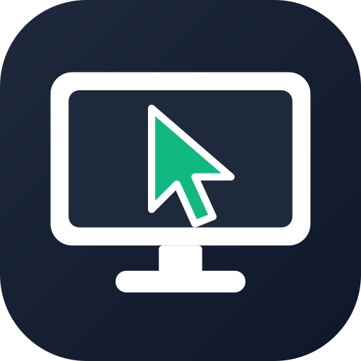

<!-- README generato da Dropbox/CLAUDE/dev/agpl-rollout/readme/genera_readme.py: modificare lì -->
<div align="center">



# tk-desk

### Assistenza remota semplice e sicura. Decide sempre chi sta al computer.

ID e password monouso da dettare al telefono, collegamento cifrato e diretto tra i due computer, conferma «Accetta» di chi riceve.

<a href="COPYING"></a>    

<br>

<a href="https://pietrodefilippis.it/software/"></a> &nbsp; <a href="https://pietrodefilippis.it/donazione/"></a>

<br><br>


</div>

---

## ✨ Cosa fa

<table>
<tr>
<td width="50%" valign="top">

### 🖥️&nbsp; Controllo a distanza
Vedi lo schermo e usi mouse e tastiera dell'altro computer, anche con più schermi.

</td>
<td width="50%" valign="top">

### ✅&nbsp; Decidi tu
A ogni collegamento compare «Accetta / Rifiuta»: senza il tuo sì nessuno entra.

</td>
</tr>
<tr>
<td width="50%" valign="top">

### 🔑&nbsp; Password che cambia
La password monouso cambia dopo ogni sessione, da sola dopo 10 minuti e dopo i tentativi sbagliati.

</td>
<td width="50%" valign="top">

### 🛡️&nbsp; Contro le truffe
Avviso contro i finti tecnici; durante un controllo nessuno può attivare accessi permanenti.

</td>
</tr>
<tr>
<td width="50%" valign="top">

### 📁&nbsp; File, chat e voce
Invii file (da accettare), scrivi in chat, parli in chiamata e registri la sessione con avviso «REC».

</td>
<td width="50%" valign="top">

### 🏢&nbsp; Accesso non presidiato
Per i tuoi computer: password fissa, rubrica e più sessioni insieme. Tutto gratis.

</td>
</tr>
</table>

## 🔒 I tuoi dati

Il collegamento è **cifrato e diretto** tra i due computer (WebRTC): lo schermo non passa da nessun server. Il centralino su pietrodefilippis.it serve solo a far trovare i due computer.

| Resta sul tuo computer | Va in rete (e perché) |
|---|---|
| Schermo, file, chat e registrazioni | Il centralino: ID, nome scelto del computer, messaggi per avviare il collegamento |
| Password fissa e rubrica, cifrate | Un server STUN di Google per trovare la strada diretta tra i due computer |
| Le impostazioni | Aggiornamenti e, solo se le accetti, statistiche anonime |

Nessuna pubblicità, nessun account da creare. Le statistiche anonime partono **solo se le accetti** al primo avvio
(si cambiano quando vuoi). Gli aggiornamenti sono **firmati digitalmente**: il programma installa solo quelli
pubblicati dall'autore.

## 📥 Installazione

- **Windows 10 / 11** — scarica lo ZIP o l'installer, estrai e avvia. Non servono i permessi di amministratore.
- **macOS** (Intel o Apple Silicon) — apri il `.dmg` e trascina l'app in *Applicazioni*. Al primo avvio: clic destro sull'app → *Apri*.
- **macOS** — al primo avvio concedi *Registrazione schermo* e *Accessibilità* (Impostazioni di Sistema → Privacy e sicurezza): servono per farti controllare.

Gli aggiornamenti arrivano da soli: quando esce una versione nuova il programma te lo propone.

<details>
<summary><b>🛠️ Avviarlo dal codice sorgente</b></summary>

<br>

Serve **Python 3.13**.

```bash
python -m venv .venv
.venv\Scripts\activate          (su macOS: source .venv/bin/activate)
pip install "pyside6-essentials==6.12.*" certifi aiortc mss pynput numpy sounddevice
python run.py
```

Prove senza rete né schermo: `python tests/test_core.py` e `python tests/test_finestre.py`.
Pacchetti: `installer\build.ps1` (Windows), `mac/build_mac.sh` (macOS).

</details>

## 📜 Licenza

**tk-desk** è software libero: © 2026 Pietro De Filippis (TecnikGeek), licenza
**[GNU Affero General Public License v3.0](COPYING)** o successiva. Puoi usarlo, studiarlo, modificarlo e
condividerlo; è fornito **così com'è, senza alcuna garanzia**. I testi delle licenze dei componenti inclusi
(aiortc, PyAV/FFmpeg, Qt/PySide6, pynput, mss, numpy, sounddevice, Python, certifi) sono nella cartella [`licenze/`](licenze/) e nel programma, in *Informazioni → Licenze e codice
sorgente*.

> Il nome **tk-desk** e il logo non sono coperti dalla licenza (AGPL, sezione 7): una versione modificata deve
> avere un nome e un logo diversi.

---

<div align="center">

**Ti è utile?** Tutte le funzioni sono gratis per tutti. Se vuoi, un caffè aiuta a migliorarlo e a crearne altri.

<a href="https://pietrodefilippis.it/donazione/"></a>

<sub>Creato da <a href="https://pietrodefilippis.it">Pietro De Filippis · TecnikGeek</a> — Webmaster & UX/UI Designer</sub>

</div>
